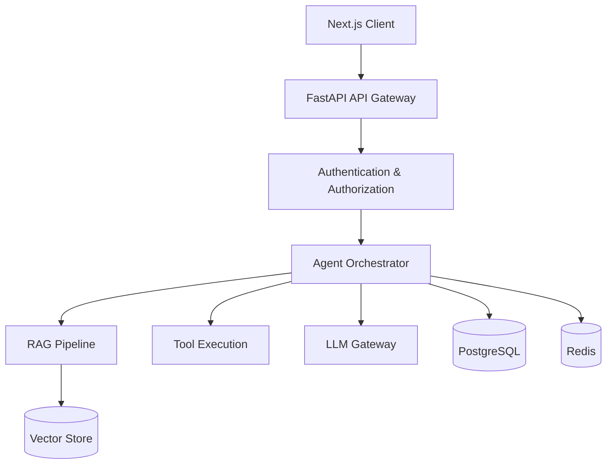

# Atlas AI Gateway - Architecture Overview

## 1. Purpose

Atlast AI Gateway is production-oriented enterprise AI platform designed to expose LLM-power capabilities through a secure, observable, and extensible API.

The platform focuses on the engineering challenges involved in moving AI workloads from prototypes to production.

Key capabilities include:

- LLM provider abstraction
- Retrieval-Augmented Generation (RAG)
- AI agent orchestration
- Tool/function calling
- structured LLM outputs
- Authentication and authorization
- Persistent conversation state
- Caching
- Observability
- Automated testing
- Containerized deployment

## 2. High-Level Architecture

## 3. Request Flow

A typical AI request follows this flow:

1. The client sends an authenticated request to the API.
2. FastAPI validates the request and authenticates the caller.
3. The request is routed to the appropriate application service.
4. The agent/orchestration layer determines what capabilities are required.
5. The system may retrieve relevant enterprise knowledge.
6. Tools may be invoked when required.
7. The LLM gateway sends the request to the configured provider.
8. The response is validated and transformed into the API contract.
9. The result is returned to the client.
10. Telemetry is recorded throughout the request lifecycle.

## 4. Architectural Principles

### Separation of concerns

API handling, business logic, AI orchestration, retrieval, persistance, and infrastructure concerns should remain independently testable.

### Provider abstraction

Application code should not depend directly on a single LLM provider.

The platform should allow providers to be replaced or extended without rewriting the application layer.

### Async by default

I/O-bound operations should use asnychronous execution where appropriate, particularly:

- API calls
- LLM requests
- database operations
- external tools

### Observable by design
Important operations should product structured logs, traces, and metrics.

AI operations should be observable in the same way as traditional distributed system operations.

### Fail explicitly

External dependencies can fail.

The platform should implement:

- timeouts
- retries
- fallbacks
- validation
- meaningful error handling

### Security by default

Secrets should never be stored in source control.

External tools should be explicitly authorized and validated before execution.

## LLM Provider Architecture

Atlas uses a provider abstraction to prevent application-level code from being coupled to a specific LLM vendor.

The application interacts with the 'LLMProvider' interface rather than directly with the provider SDKS,

Current implementations include:

- Mock provider
- Azure OpenAI provider

This design allows additional providers to be introduced without changing the API or application layers.

The provider layer is also responsible for handling external-provider concerns such as:

- timeouts
- retries
- provider-specific errors
- response normalization